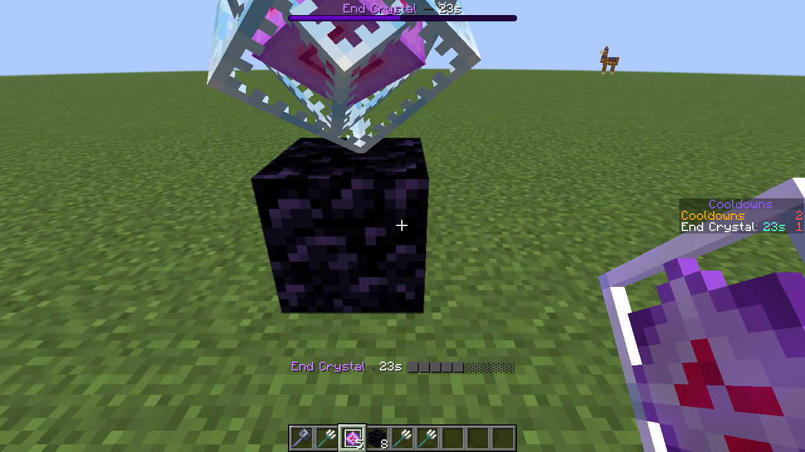
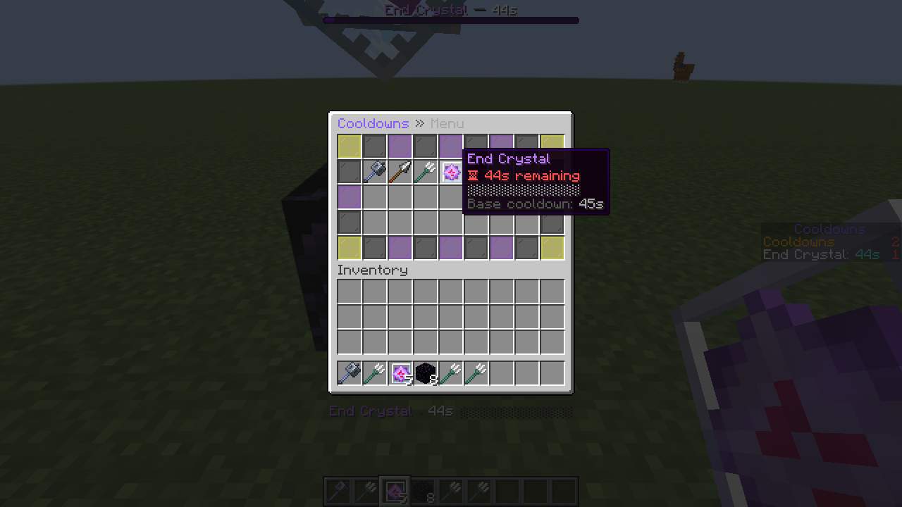

# ItemCooldowns

**Control the pace of PvP. Keep every cooldown visible.**

Configurable cooldowns for combat items, with a live menu, ActionBar, BossBar, sidebar, sounds and particles. Server-side: players need no client mod or resource pack.

[Download on Modrinth](https://modrinth.com/plugin/item_cooldowns/versions) · [Gameplay gallery](https://modrinth.com/plugin/item_cooldowns/gallery) · [Configuration](src/main/resources/config.yml) · [Report an issue](https://github.com/sooqwess/itemcooldowns/issues)

> **v2.0.0 is a beta.** Verified on **Paper 1.21.11 build 132** with a real vanilla client. Other versions and server forks are development targets, not certified compatibility. Back up your configuration before upgrading.

## Built for readable combat

- **Per-player cooldowns.** One player's timer never blocks another player. Storage is isolated by UUID and material, with an atomic check/start to prevent simultaneous attempts from slipping through.
- **Live feedback.** ActionBar, BossBar, sidebar, chat, sounds and particles can be configured independently.
- **A menu players can read.** `/cooldowns` opens a purple-and-gold menu with ready status, remaining seconds and a progress indicator.
- **Trident timing that makes sense.** The timer starts when the projectile launches, not while the player charges the throw.
- **Readable blocked feedback.** Repeated attempts are cancelled when configured; messages, sounds and particles are limited to one feedback burst per player per second.
- **Ten bundled languages.** Choose each player's client language automatically, or force one server-wide language.
- **Server controls.** Per-item durations, bypass permissions, world filtering and an optional Creative → Survival switch for PvP hits.
- **Optional integrations.** Built-in PlaceholderAPI placeholders, permission management through plugins such as LuckPerms, and a PvPManager hook.

## In-game preview

These are **unaltered Minecraft screenshots** from the isolated Paper test server: no AI gameplay images, added captions or external presentation frames.

### Live cooldown display



### Player cooldown menu



[View blocked-use feedback and the trident launch in the gallery →](https://modrinth.com/plugin/item_cooldowns/gallery)

## Install in a minute

1. Stop your server and back up the existing ItemCooldowns configuration and locale files.
2. Download **ItemCooldowns 2.0.0 Beta** and place its JAR in `plugins/`. Remove the previous ItemCooldowns JAR; do not keep both.
3. Start the server. The plugin creates `plugins/ItemCooldowns/config.yml` and the bundled `lang/` templates.
4. Review your rules, then use `/icd gui` in-game. After configuration changes, use `/icd reload`.

**Upgrading from v1:** existing settings and on-disk translations are retained. Old locale files override the new defaults; back up and regenerate them if you want the complete v2 wording and colors. Prefer a full restart for plugin updates.

## Item rules

| Item | Default timer | Enabled by default | Trigger |
|---|---:|:---:|---|
| Mace | 45 s | Yes | Melee hit; PvP only by default |
| Spear variants available on the server | 5 s | Yes | Attack / configured use policy |
| Trident | 5 s | Yes | Projectile launch, melee, Riptide event |
| End crystal | 45 s | Yes | Block-use attempt / crystal interaction |
| Respawn anchor | 45 s | Yes | Placement or supported block-use attempt |
| Ender pearl | 5 s | No | Right-click use |
| Bow | 2 s | No | Shot |
| Crossbow | 5 s | No | Shot |
| Shield | 5 s | No | Right-click use |
| Totem of Undying | 30 s | No | Resurrect event |
| Wind charge | 3 s | No | Right-click use |

Each rule has its own enable switch, duration, action cancellation, vanilla overlay and bypass permission. Unsupported materials are skipped. Timers are stored **per material**, not shared across every spear variant, and reset on disconnect.

## Configuration

The [complete config.yml](src/main/resources/config.yml) documents all defaults. A typical item rule looks like this:

```yaml
locale: auto
pvp-only: true
creative-to-survival-on-player-hit: false

trident:
  enabled: true
  cooldown-seconds: 5
  cancel-action: true
  overlay: true
  use-mode: block
  bypass-permission: itemcooldowns.bypass.trident
  actionbar: true
  bossbar: true
```

### Choose your feedback

ActionBar, BossBar, GUI, sidebar, sounds and particles are enabled in a fresh v2 configuration. Toggle each under `visuals.<channel>.enabled`.

- **Another sidebar plugin?** Disable `visuals.scoreboard.enabled`; ItemCooldowns temporarily replaces the player's scoreboard while a timer is active and attempts to restore it afterwards.
- **Want a blocked message on every permitted feedback interval?** Native item overlays can stop the client from sending repeated-use packets. Set that item's `overlay: false` to rely on the server HUD instead. The crystal screenshots use this setting.
- **World filtering:** `worlds.enabled`, `worlds.whitelist` and `worlds.list` control where rules apply.
- **Creative PvP:** `creative-to-survival-on-player-hit` is off by default. Enable it only if attackers should be switched to Survival when hitting another player.

### Weapon use policies

Spear and trident rules accept `use-mode`:

| Value | Behavior |
|---|---|
| `block` | Gate the use while its cooldown is active. Fresh v2 default. |
| `damage` | Allow the use while gating damage. Tridents launched during a running timer are marked harmless; the first valid throw can deal damage. |
| `no-damage` | Allow the use but suppress its use damage; melee remains cooldown-gated. |

Explicit v1.01 values and the legacy `block-use` option are supported. Spear/Riptide use-damage attribution uses a 1.5-second heuristic and may also suppress melee within that window. These optional policies still need dedicated gameplay testing.

## Commands & permissions

Command aliases: `/itemcooldowns`, `/icd`, `/cooldowns`.

| Command | What it does | Permission |
|---|---|---|
| `/icd` or `/icd gui` | Open the player menu | `itemcooldowns.use` — default true |
| `/icd check [item]` | Show remaining time | Everyone |
| `/icd help` | Show help | Everyone |
| `/icd reset [player]` | Clear timers; omitted player means yourself | `itemcooldowns.admin` — default operators |
| `/icd reload` | Reload config/locales and clear plugin timers | `itemcooldowns.admin` |

Bypass all rules with `itemcooldowns.bypass`, or one rule with `itemcooldowns.bypass.<item-key>`. **Bypasses default to false, including for operators.**

Example with LuckPerms:

```text
/lp group vip permission set itemcooldowns.bypass.trident true
```

Item keys: `mace`, `spear`, `trident`, `end-crystal`, `respawn-anchor`, `ender-pearl`, `bow`, `crossbow`, `shield`, `totem`, `wind-charge`.

## Languages

**English · Русский · Deutsch · Español · Français · Português · 中文 · 日本語 · 한국어 · Українська**

Use `locale: auto` to match a player's client language, or `locale: en`, `ru`, `de`, `es`, `fr`, `pt`, `zh`, `ja`, `ko`, `uk` to force one language. Auto selection recognizes these ten language families, including regional variants such as `pt_br`.

Edit `lang/messages-<code>.yml` to customize text, `&` colors and `&#RRGGBB` hex colors. Missing keys fall back to bundled English. A custom language can be selected explicitly with `locale: <code>`.

## Integrations

### PlaceholderAPI — optional

The expansion registers automatically when PlaceholderAPI is installed; no eCloud expansion download is needed.

| Placeholder | Result |
|---|---|
| `%itemcooldowns_active%` | Number of active cooldowns |
| `%itemcooldowns_nearest%` | Selected item key, or `ready` |
| `%itemcooldowns_nearest_seconds%` | Selected remaining seconds, or `0` |
| `%itemcooldowns_trident_seconds%` | Trident remaining seconds |
| `%itemcooldowns_trident_ready%` | `true` / `false` |

Replace `trident` with another item key. Multi-material item status uses the longest remaining timer across that rule's materials. The current `nearest` selection also means the **longest remaining** timer.

### PvPManager — optional

The included hook checks recognized PvPManager APIs before applying melee cooldowns. Toggle it with `pvpmanager.enabled`. Installed PvPManager and PlaceholderAPI still need integration testing in this beta.

## Compatibility & beta status

| Status | Environment |
|---|---|
| **Verified runtime** | Paper **1.21.11 build 132**, Java 21; real vanilla-client screenshots |
| **Automated checks** | 11 tracker assertions; 64 concurrent attempts produce exactly one start |
| **Language templates** | All 10 parse and contain the same 38 message keys |
| **Development target — not fully verified** | Minecraft **1.21–26.3**, Spigot/Bukkit-compatible forks, Purpur, Pufferfish, Leaves and Folia |

The published v2 beta is tagged **Paper / 1.21.11** only. Broader version/fork support, Folia's multi-region runtime, installed integrations and optional item/use-policy scenarios need additional tests. See the [verification report](docs/TESTING.md) for exact coverage and limitations.

The JAR targets **Java 21 bytecode**. Always use the runtime required by your Minecraft server, which may be newer. Proxy servers such as Velocity/BungeeCord/Waterfall cannot run this Bukkit plugin directly; Fabric/Quilt bridges are not tested.

## Notes before deploying

- Crystal and anchor rules gate interaction attempts, not confirmed successful placements.
- Cooldowns are not persisted and reset on disconnect. Config reload clears plugin timers; a full restart is preferable for upgrades, particularly with native overlays.
- The menu uses vanilla inventory chrome and colored glass. A fully custom inventory background would require a resource pack; none is required or included.
- Brand artwork is AI-assisted and selected by the project owner. **Gameplay screenshots are genuine client captures**, not generated artwork.

## Build & contribute

Java 21+ and Maven 3.9+:

```sh
mvn package
bash tools/test-tracker.sh
```

Output: `target/ItemCooldowns-2.0.0.jar`. The tracker assertions are explicitly run by the script; they are not a JUnit suite automatically executed by Surefire.

Found a bug? [Open an issue](https://github.com/sooqwess/itemcooldowns/issues) with your server build, Java version, configuration and reproduction steps. Remove passwords, tokens and other private data from logs before posting.

**MIT · Sooqwess**
