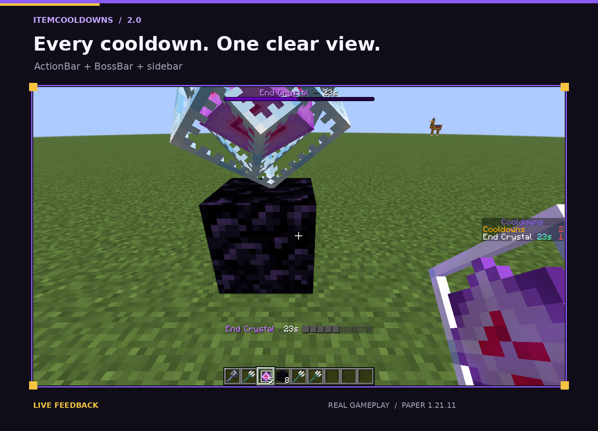
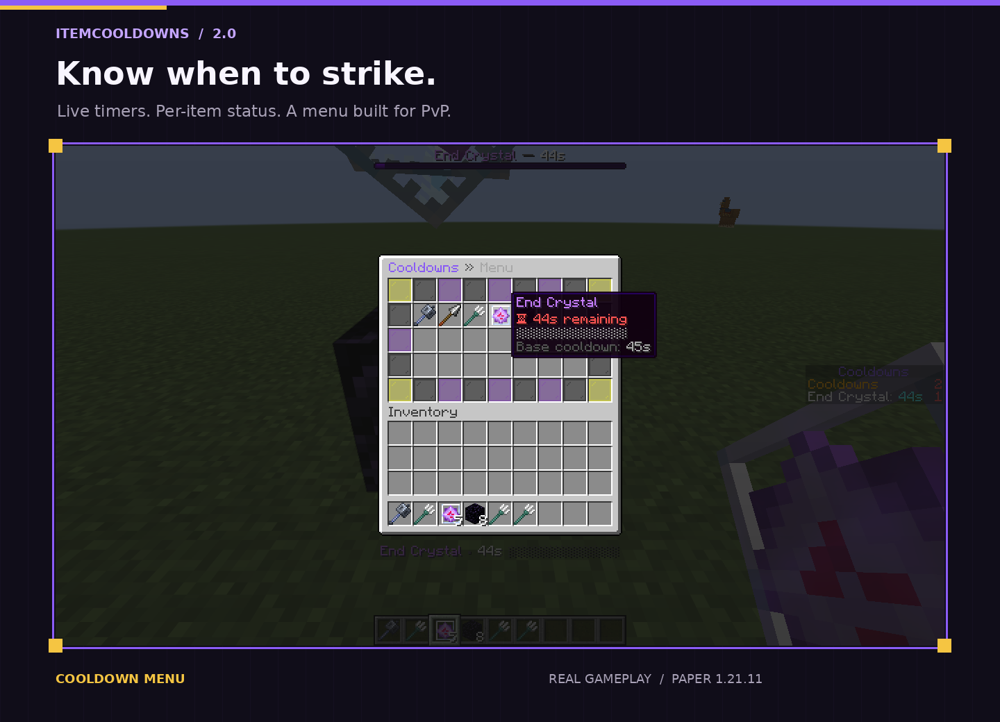

<div align="center">

# ItemCooldowns · 2.0

**Clear timing. Fair fights.**

PvP item cooldowns with a purple-and-gold menu, live timers and per-player protection.

[Modrinth](https://modrinth.com/plugin/item_cooldowns) · [Gallery](docs/gallery/index.html) · [Test report](docs/TESTING.md)



</div>

## What's new

- **Live feedback:** ActionBar, BossBar, sidebar, sounds and particles, individually configurable.
- **Cooldown menu:** `/icd` or `/cooldowns`, with a pixel-style purple/gold border, ready status, remaining time and a progress indicator.
- **10 bundled languages:** English, Russian, German, Spanish, French, Portuguese, Chinese, Japanese, Korean and Ukrainian.
- **`locale: auto`:** use each player's client language; set `locale: ru` (or another code) to force one language.
- **Optional PlaceholderAPI integration** for custom HUDs and menus.
- **Per-player, per-material storage:** atomic check/start prevents concurrent attempts from bypassing a running timer.
- **Spam-limited blocked feedback:** at most one message/sound/particle burst per player per second; every disallowed attempt is still cancelled.
- **Tridents start on launch**, not on right-click or during charging. Bows/crossbows use the actual shot event.
- Optional **Creative → Survival** conversion when a Creative player hits another player; off by default.

## Compatibility: target vs. verification

**Target:** Minecraft **1.21–26.3**, on Bukkit-compatible servers: Paper, Spigot, Bukkit, Purpur, Pufferfish, Leaves and Folia. Unsupported materials are resolved by name and automatically skipped on older versions.

**Actually verified in this workspace:** Paper **1.21.11 build 132**, with a real vanilla client, plus 11 standalone tracker assertions. This is **not** proof that every version/core combination works. Folia, Spigot, the 26.x runtime and PlaceholderAPI still require separate integration tests; see the [test report](docs/TESTING.md).

The plugin is compiled to **Java 21 bytecode**. Use the Java runtime required by your Minecraft server; newer Minecraft releases may require a newer Java version. Proxy servers (BungeeCord/Waterfall/Velocity), Fabric and Quilt are not standalone Bukkit plugin hosts. Compatibility bridges are not tested or guaranteed.

## Installation / upgrade

1. Back up the existing configuration and language files.
2. Stop the server. Remove the previous ItemCooldowns JAR (do not keep both versions).
3. Install `ItemCooldowns-2.0.0.jar` into `plugins/` and start the server.
4. Review `plugins/ItemCooldowns/config.yml`, particularly the visual and optional-item sections.
5. Existing values and on-disk locale customizations are retained. To adopt the new translated wording/colors fully, back up and regenerate the old locale files.

No resource pack or client mod is required. Vanilla inventory chrome stays vanilla; a fully custom dark inventory background would require a resource pack. The menu uses colored glass borders and styled text without one.

## Default rules

| Item | Duration | Enabled by default | Trigger |
|---|---:|:---:|---|
| Mace | 45 s | Yes | PvP hit |
| Spear (available materials only) | 5 s | Yes | Attack/use |
| Trident | 5 s | Yes | Actual projectile launch, melee attack, Riptide event |
| End crystal | 45 s | Yes | Right-click block use attempt |
| Respawn anchor | 45 s | Yes | Right-click block use attempt |
| Ender pearl | 5 s | No | Right-click use |
| Bow | 2 s | No | Shot |
| Crossbow | 5 s | No | Shot |
| Shield | 5 s | No | Right-click use |
| Totem | 30 s | No | Resurrect event |
| Wind charge | 3 s | No | Right-click use |

Cooldowns reset on disconnect and are not persisted. Crystal/anchor rules gate use attempts, not confirmed successful placements. Bypass permissions default to **false**, including for operators.

## Commands

Aliases: `/itemcooldowns`, `/icd`, `/cooldowns`.

| Command | Purpose | Permission |
|---|---|---|
| `/icd` or `/icd gui` | Open the live menu | `itemcooldowns.use` (default true) |
| `/icd check [item]` | Check remaining time | Everyone |
| `/icd help` | Help | Everyone |
| `/icd reset [player]` | Clear timers; omitted player means yourself | `itemcooldowns.admin` |
| `/icd reload` | Reload config/locales; clears plugin timers | `itemcooldowns.admin` |

## Configuration

The complete, commented [config.yml](src/main/resources/config.yml) ships in the JAR.

```yaml
locale: auto  # or en, ru, de, es, fr, pt, zh, ja, ko, uk
pvp-only: true
creative-to-survival-on-player-hit: false

visuals:
  actionbar:
    enabled: true
  bossbar:
    enabled: true
  scoreboard:
    enabled: true
  gui:
    enabled: true
  sounds:
    enabled: true
  particles:
    enabled: true

trident:
  enabled: true
  cooldown-seconds: 5
  cancel-action: true
  overlay: true
  bypass-permission: itemcooldowns.bypass.trident
  actionbar: true
  bossbar: true
```

**Sidebar interoperability:** disable `visuals.scoreboard.enabled` if another plugin owns the sidebar. ItemCooldowns temporarily replaces the player's scoreboard while a timer is active and tries to restore the previous one afterwards.

**Vanilla overlay vs. blocked feedback:** the white slot overlay may make the client suppress repeated use packets. The server cannot display a new blocked message for a packet it never receives. For server-driven blocked feedback on items such as crystals, set that rule's `overlay: false`; ActionBar/BossBar/sidebar still show the timer. Gallery capture uses this setting for crystals.

`worlds.enabled`, `worlds.whitelist` and `worlds.list` provide world filtering. Set the Creative → Survival option to true only if that gameplay change is intended.

## Languages / customization

The first launch extracts `lang/messages-<code>.yml` for all ten bundled languages. Missing keys fall back to the bundled English template. To add a custom language, copy a template and set `locale: <code>`. Auto selection recognizes the ten bundled language families, including regional client codes such as `pt_br`.

Message placeholders: `{item}`, `{seconds}`, `{progress}`, `{player}` where relevant. Supports `&` formatting and `&#RRGGBB` hex colors. Sounds and particles can be disabled independently; unknown enum names are ignored.

## Permissions

- `itemcooldowns.use`: menu access, default true.
- `itemcooldowns.admin`: reload/reset, default operators.
- `itemcooldowns.bypass`: bypass all rules, default false.
- `itemcooldowns.bypass.<item-key>`: bypass a single rule, default false.

Item keys: `mace`, `spear`, `trident`, `end-crystal`, `respawn-anchor`, `ender-pearl`, `bow`, `crossbow`, `shield`, `totem`, `wind-charge`.

LuckPerms example: `/lp group vip permission set itemcooldowns.bypass.trident true`.

## PlaceholderAPI (optional)

Install PlaceholderAPI; the expansion registers automatically. No eCloud download is needed.

| Placeholder | Result |
|---|---|
| `%itemcooldowns_active%` | Active cooldown count |
| `%itemcooldowns_nearest%` | Selected active item key or `ready` |
| `%itemcooldowns_nearest_seconds%` | Selected timer in seconds, or `0` |
| `%itemcooldowns_trident_seconds%` | Trident remaining seconds |
| `%itemcooldowns_trident_ready%` | `true` / `false` |

Replace `trident` with another item key for the item-specific placeholders. The current `nearest` selection uses the **longest remaining** timer. For multi-material rules, item-specific status shows the longest remaining timer across their materials; the tracker stores each material separately.

## Gallery

Real captures from an isolated Paper test server, not AI concepts. Four presentation cards add external typography/framing only. Untouched screenshots are included in [docs/gallery/originals](docs/gallery/originals/).



## Build / test

Java 21+ and Maven 3.9+:

```sh
mvn package
bash tools/test-tracker.sh
```

Output: `target/ItemCooldowns-2.0.0.jar`. The standalone tracker test is explicitly invoked by the script; it is not a JUnit suite automatically executed by Surefire. To regenerate the presentation gallery, install Pillow and run `python3 tools/make-gallery.py` (the script uses DejaVu fonts).

## License

MIT · Sooqwess
